# Process Station

A desk-sized automation cell that reproduces the full vertical stack of an industrial installation: field devices, a local controller, a protocol gateway and a SCADA system.

Arduino UNO firmware handles control, a latched high-temperature alarm and local operation on its own. A Node-RED flow exposes the station as a Modbus TCP server. Ignition Maker Edition 8.3.10 provides tags, a reusable UDT, a Perspective HMI, supervisory alarms and a SQLite historian.

This is a personal portfolio project by Victor Gabriel Hernández Morera, 5th-year Industrial Electronics and Automation Engineering student at Universidad de La Laguna, Tenerife. The Arduino is a prototype controller, not a PLC; the SCADA side is built so that the controller can later be replaced by a Siemens S7-1500 without redesigning the HMI.

Demo video: [Watch the demo on YouTube](https://youtu.be/0CmcolezmKc)

Technical report (PDF): [docs/Process_Station_Report.pdf](docs/Process_Station_Report.pdf)

## Problem

I wanted to practise, on hardware I could build at a desk, the same chain of tasks an automation engineer handles on a commissioning job: local control that stays safe if the supervisor is offline, a standard industrial protocol with a documented register map, a scalable tag model, alarm management, historisation, and an HMI designed with some discipline rather than a colourful dashboard.

## Role

I designed and built the station end to end: wiring and I/O, Arduino firmware, the Node-RED gateway, the Ignition tag model and UDT, the Perspective HMI, the test cases, the demonstration video and the technical report.

## Architecture

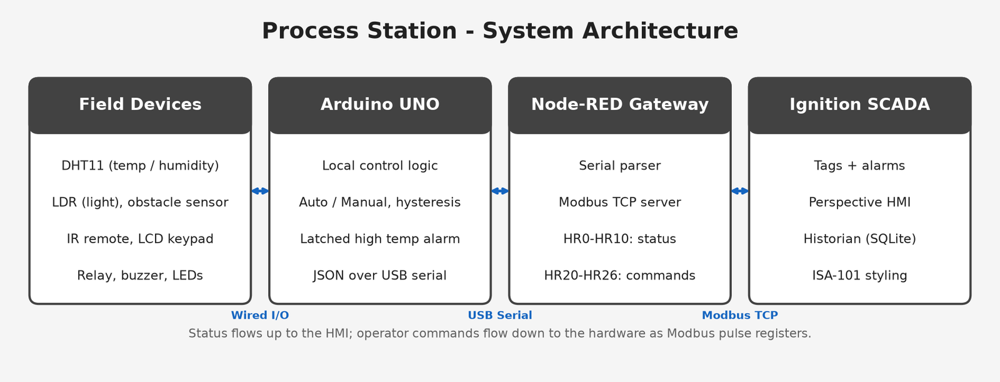

Status flows up to the HMI; operator commands flow down to the hardware as Modbus pulse registers.

Arduino UNO -> Node-RED serial-to-Modbus TCP gateway -> Ignition Maker 8.3.10 Perspective.

## Stack

| Layer | Component | Notes |
|---|---|---|
| Field | DHT11, LDR, KY-032 obstacle sensor, IR remote, LCD keypad shield, relay, buzzer, LEDs | Wired I/O to the UNO |
| Controller | Arduino UNO (Funduino / UNO R3) | Local AUTO/MANUAL logic, hysteresis, latched alarm, JSON over USB serial at 115200 baud |
| Gateway | Node-RED (`node-red-node-serialport`, `modbus-serial`) | Serial parser and Modbus TCP server, unit ID 1, port 502 |
| SCADA | Ignition Maker Edition 8.3.10 (Perspective, tags, alarms, historian) | Modbus TCP device at 127.0.0.1:502, Default tag group polled every 1000 ms. See the licence note below |

Ignition was used under **Ignition Maker Edition 8.3.10**, which is a free licence for non-commercial and personal educational use only. This project is a personal educational / portfolio build and is not a commercial application. Do not use Maker Edition for commercial work. For classroom or senior-project licences, contact Inductive Automation.

## Features

- **UDT `AnalogSensor` and instance `TT101`.** Parameter `basePath` points at the raw status folder. `Value`, `Setpoint` and `HighLimit` are Float4. `Value` and `Setpoint` are reference tags; `HighLimit` is the expression `{[.]Setpoint} + 3`; `Units` is a memory tag (`°C`). The HighTemperature alarm and the historian sit on `Value`.
- **HighTemperature alarm (ISA-18.2).** Mode is Above Setpoint, limit = `HighLimit`, priority High. A 0.5 Absolute deadband, a 2 s on-delay (`timeOnDelaySeconds`) and a 5 s off-delay (`timeOffDelaySeconds`) reduce chattering and nuisance alarms.
- **Perspective HMI.** Main view is a fixed coordinate container (2019 × 1018). Status indicators, light and humidity gauges, a thermometer with setpoint entry, command buttons, a Power Chart and an alarm status table. The left-hand alarm indicator is bound to `[default]ProcessStation/TT101/Value/Alarms.HasActive`.
- **LOCAL ALARM indicator.** A separate indicator under RUN (`EmbeddedView_LocalAlarm`) is bound to the latched Arduino bit `[default]ProcessStation/Status/Alarm` (HR7). That tag is enabled; its own Ignition alarm is disabled so it does not duplicate the supervisory alarm on `TT101/Value`.
- **Sensor popup.** Clicking the thermometer opens `Popups/SensorDetail`, parameterised by `udtPath`, with value, setpoint, high limit, units and a mini trend. The same popup works for any `AnalogSensor` instance.
- **Local vs supervisory alarms.** The Arduino raises a latched local alarm (buzzer, red LED, "!" on the LCD) that keeps the station safe if the PC is off. Ignition raises the supervisory HighTemperature alarm on the UDT, with a full life cycle: active, cleared, acknowledged. The two can be briefly out of step; that is documented and intentional.
- **SQLite historian.** `Value` is logged every second to `Sample_SQLite_Database`, which prunes samples after one week. The Power Chart plots temperature, setpoint, humidity and light, with two axes.
- **ISA-101 styling.** Grey for normal states, blue for operator-entered values, red only for alarms. Indicators and buttons are reusable templates driven by shared style classes.

## Tests

16 of 17 documented test cases pass on the live system. T10 (DHT11 fault) still needs someone at the bench to disconnect the sensor and record the result.

## Modbus register map

The gateway maps each JSON frame from the Arduino into holding registers. Command registers are pulses: Ignition writes a value, the gateway sends the matching serial command, and the register is cleared back to 0. Off / MANUAL / STOP use value 2, not 0, so that 0 can stay the idle value of a pulse register.

The Ignition device `ProcessStation` is Modbus TCP at 127.0.0.1:502 (unit ID 1, zero-based addressing). The Default tag group polls every 1000 ms.

### Status (Arduino to Ignition)

| Register | Signal | Scaling / values |
|---|---|---|
| HR0 | Temperature | ×10 (245 = 24.5 °C); 0 if sensor fault |
| HR1 | Relative humidity | %; 0 if sensor fault |
| HR2 | Light level | % |
| HR3 | Obstacle detected | 0/1 |
| HR4 | Relay output | 0/1 |
| HR5 | Mode | 1 = AUTO, 0 = MANUAL |
| HR6 | Setpoint | ×10 |
| HR7 | High-temperature alarm (latched) | 0/1 |
| HR8 | Run status | 0/1 |
| HR9 | DHT11 sensor OK | 0/1 |
| HR10 | Heartbeat | +1 per frame (~1 s), 16-bit wrap |

### Commands (Ignition to Arduino, pulse)

| Register | Command | Values |
|---|---|---|
| HR20 | New setpoint | ×10 (275 = 27.5 °C) → `SP=27.5` |
| HR21 | Mode | 1 → `MODE=AUTO`, 2 → `MODE=MANUAL` |
| HR22 | Relay (MANUAL only) | 1 → `RELAY=1`, 2 → `RELAY=0` |
| HR23 | Alarm reset | 1 → `RESET` |
| HR24 | Silence buzzer | 1 → `MUTE` |
| HR25 | Run / stop | 1 → `RUN=1`, 2 → `RUN=0` |
| HR26 | Output test | 1 → `TEST` |

## Screenshots

### Hardware

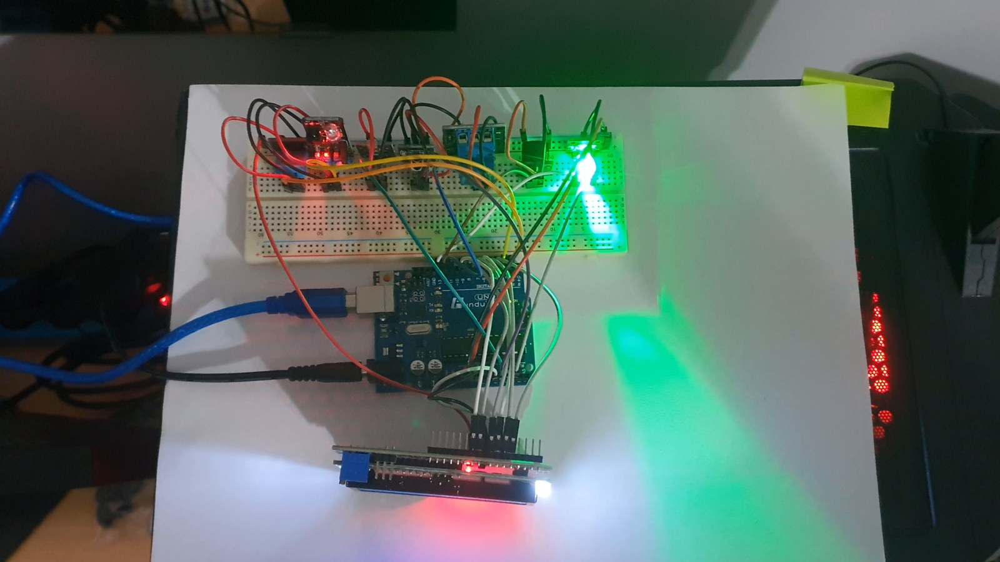

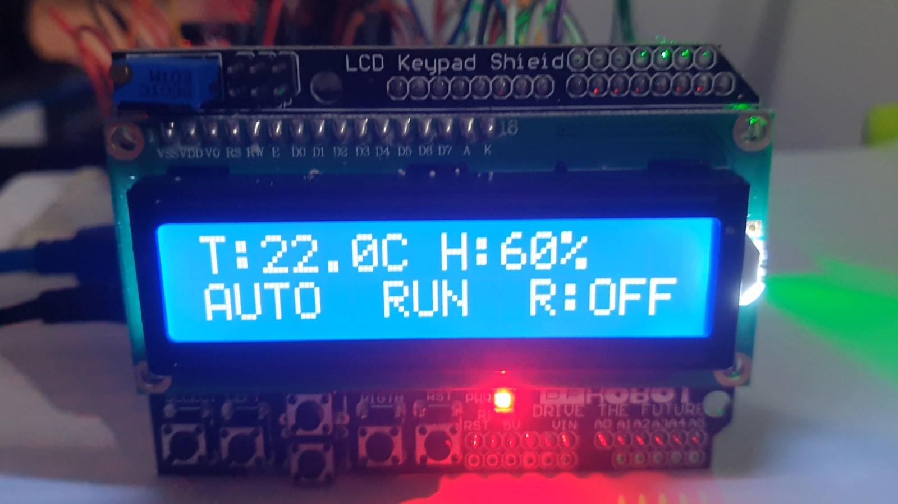

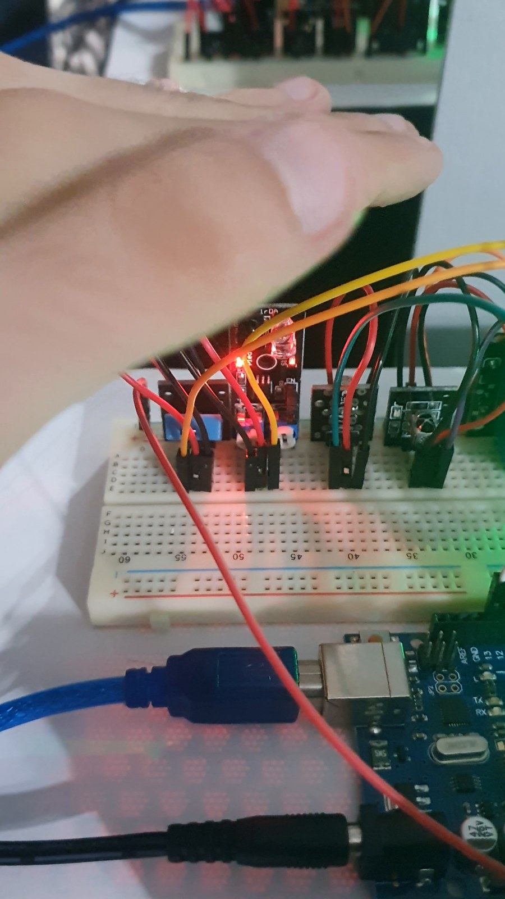

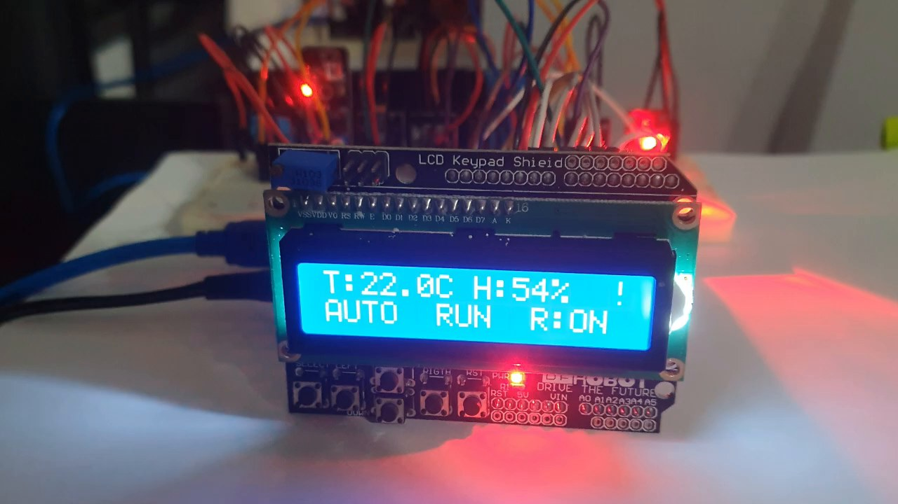

### Gateway and tags

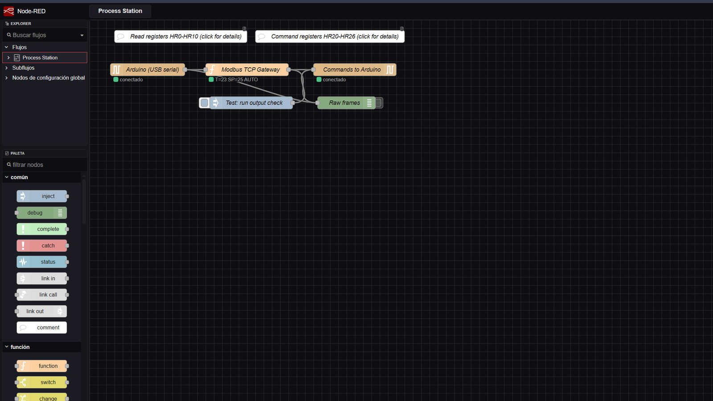

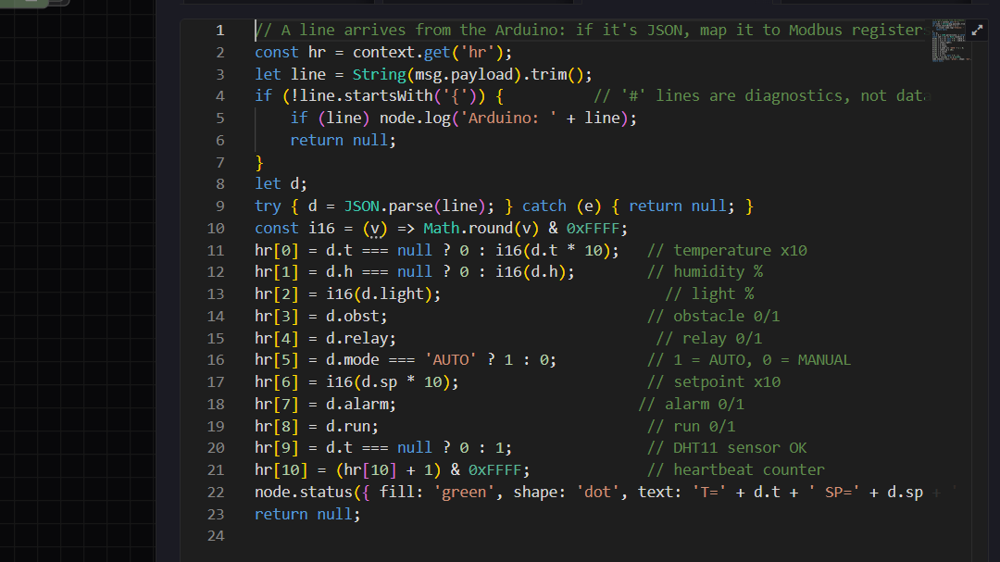

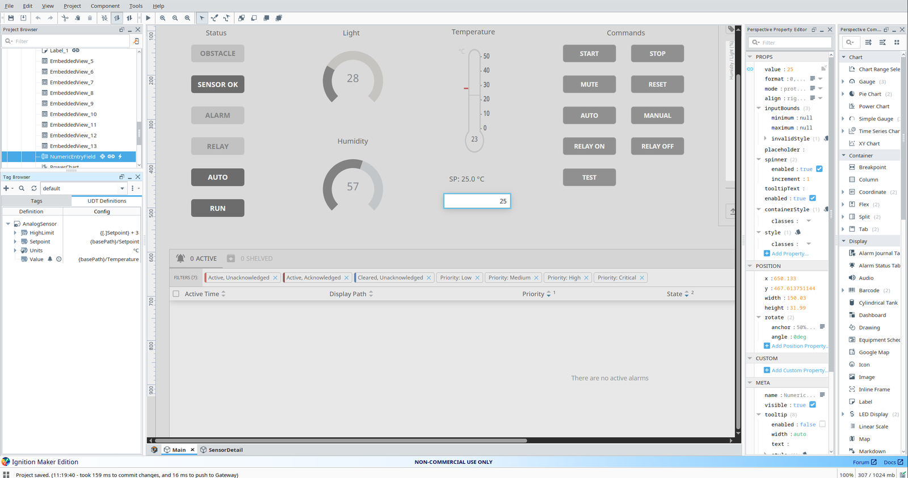

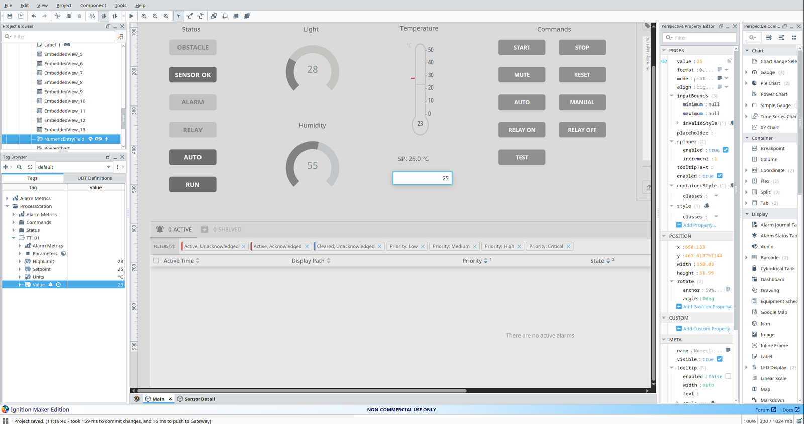

### Perspective HMI

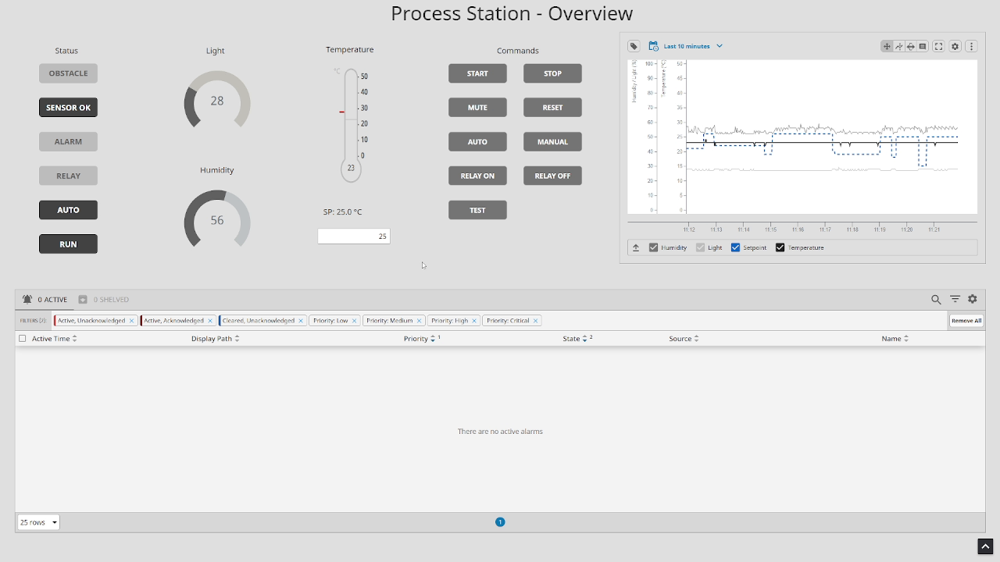

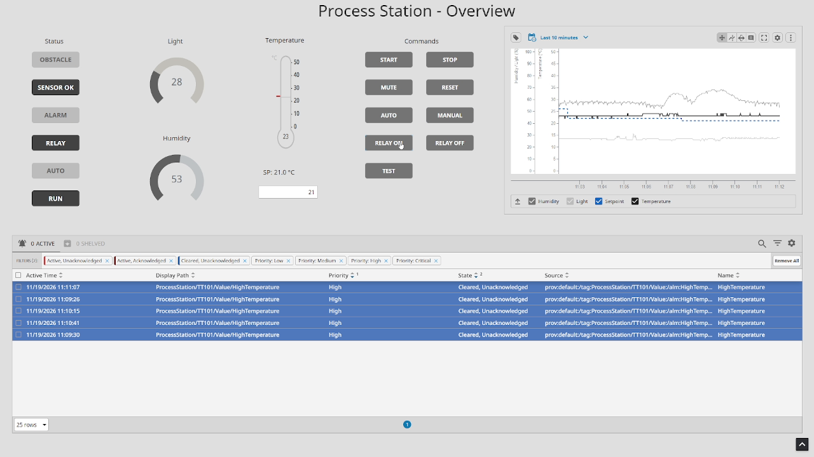

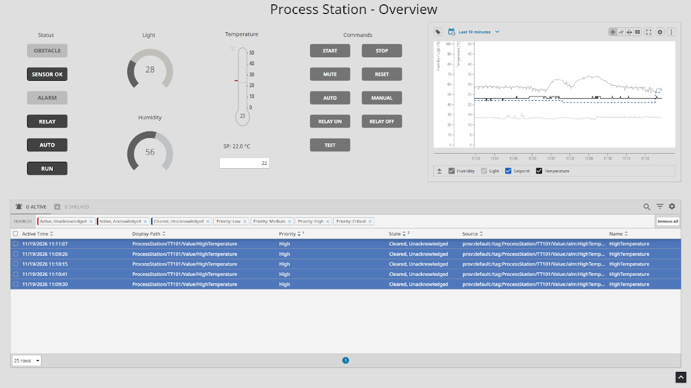

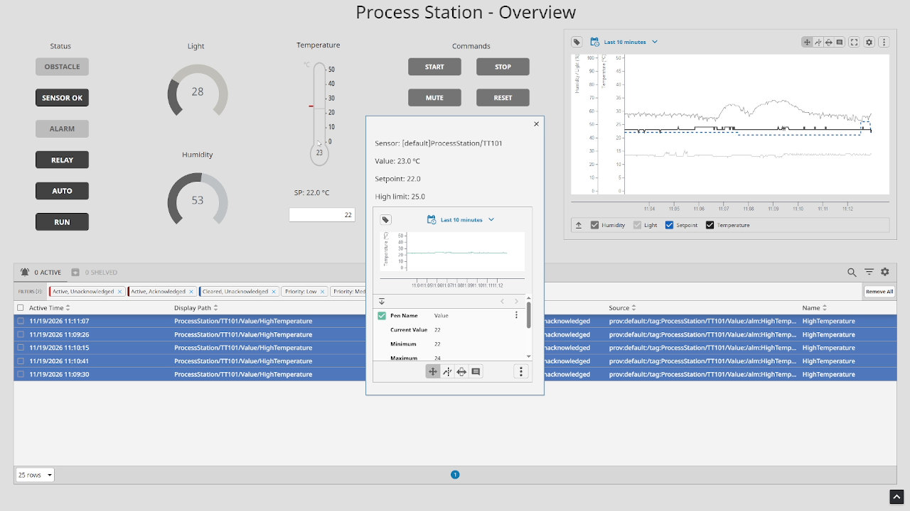

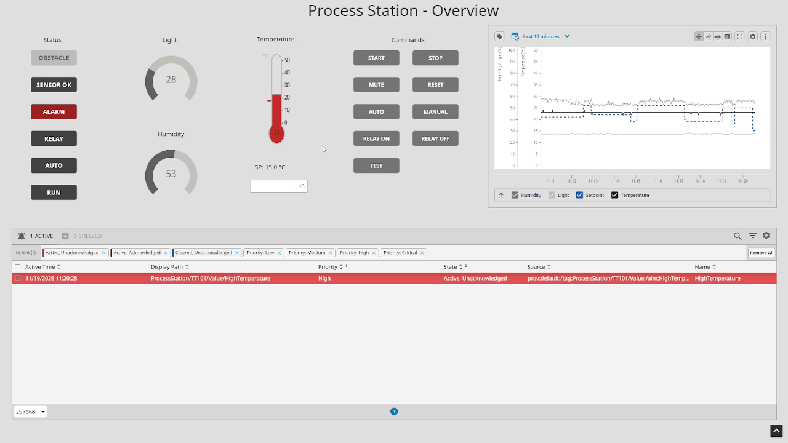

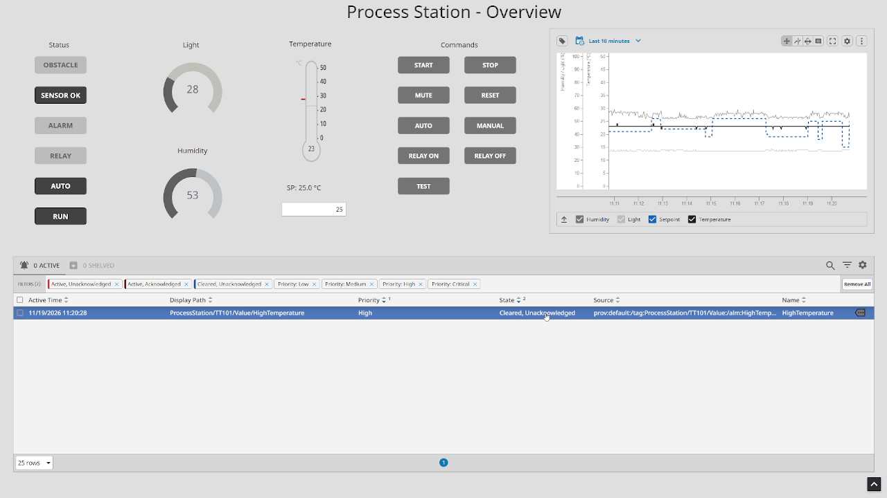

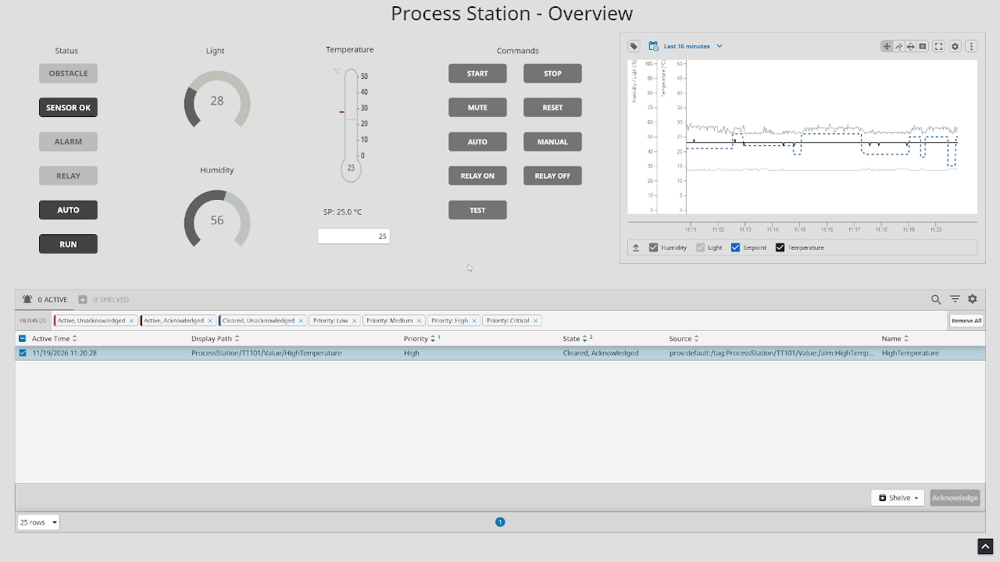

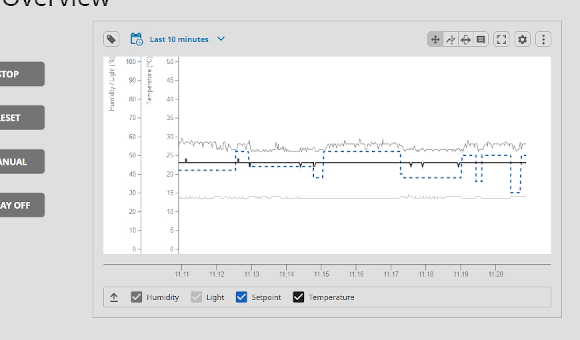

## Demo video

A 2:40 English walkthrough of the architecture, the hardware, the gateway, the Ignition project and a live demo (setpoint change, AUTO/MANUAL, high-temperature alarm and acknowledgement):

[Watch the demo on YouTube](https://youtu.be/0CmcolezmKc)

## Technical report

The English technical report covers architecture, firmware, the register map, the UDT and HMI, test cases, problems found and next steps:

[docs/Process_Station_Report.pdf](docs/Process_Station_Report.pdf)

## How to reproduce

You will need an Arduino UNO (or compatible) wired as in the report, a PC with Node-RED, and a non-commercial Ignition Maker Edition 8.3 licence.

### 1. Arduino firmware

1. Install [Arduino IDE 2](https://www.arduino.cc/en/software).
2. In **Library Manager** install **DHT sensor library** (Adafruit, install dependencies when asked), **Adafruit Unified Sensor**, and **IRremote** (Armin Joachimsmeyer, 4.x). LiquidCrystal ships with the IDE.
3. The sketch must sit in a folder of the same name. Copy `arduino/process_station.ino` into a folder named `process_station` and open it.
4. Board: **Arduino Uno**. Select your serial port (on Windows this is often COM3, COM4 or COM5; some Funduino boards need a CH340 driver).
5. Upload, then open the Serial Monitor at **115200** baud. You should see a JSON line about once per second, for example:

```text
{"t":24.5,"h":40,"light":63,"obst":0,"relay":1,"mode":"AUTO","sp":26.0,"alarm":0,"run":1}
```

Lines starting with `#` are diagnostics, not process data. If the DHT11 fails, `t` and `h` are `null`.

Serial commands (newline-terminated): `SP=27.5`, `MODE=AUTO`, `MODE=MANUAL`, `RELAY=1`, `RELAY=0`, `RESET`, `MUTE`, `TEST`, `RUN=1`, `RUN=0`. Legacy forms `MODO=` and `RELE=` are still accepted.

If the IR remote does nothing, press each key with the Serial Monitor open, note the `# IR command=0x..` values, and update the codes at the top of the sketch. Relay polarity, buzzer polarity and light inversion are also set there.

### 2. Node-RED gateway

1. Install Node-RED, then `node-red-node-serialport` and `modbus-serial`.
2. Import `node-red/process_station_flow.json`.
3. Open the serial-port configuration and set it to the port of your Arduino. The published flow uses `COM5` as an example from a Windows machine; change it to whatever port the IDE shows.
4. Deploy. The function node starts a Modbus TCP server on `0.0.0.0:502`, unit ID 1. The node status should show the latest temperature, setpoint and mode.

### 3. Ignition Maker Edition 8.3

1. Install Ignition Maker Edition 8.3 and confirm the licence is for non-commercial / personal educational use.
2. Add a Modbus TCP device named `ProcessStation` pointing at the Node-RED host (on the same PC that is usually `127.0.0.1`, port 502, unit ID 1, zero-based addressing). The settings in `ignition/device_ProcessStation/config.json` can be used as a reference.
3. Import the live tag exports, in this order (see `ignition/README.md`):
   - Tag Browser > UDT Definitions > right-click > Import Tags: `ignition/udt_AnalogSensor.json`.
   - Tag Browser > `[default]` > right-click > Import Tags: `ignition/tags_ProcessStation.json` (folder `ProcessStation` with `Status`, `Commands` and UDT instance `TT101`).
4. Import the Perspective project from `ignition/ProcessStation_project_export.zip` (Gateway > Projects > Import), or copy `ignition/project_ProcessStation/` into `data/projects/ProcessStation`. The export includes views `Main` and `Popups/SensorDetail`, templates `StatusIndicator` and `CommandButton`, and the style classes.
5. Confirm that the left-hand alarm indicator is bound to `[default]ProcessStation/TT101/Value/Alarms.HasActive`, and that LOCAL ALARM under RUN is bound to `[default]ProcessStation/Status/Alarm`.
6. If the Power Chart pens do not plot on another machine, adjust their historian source: they may still contain the original gateway name and must be pointed at the local `Sample_SQLite_Database` provider. Set that historian to prune samples after one week if you recreate it from scratch.

A full Gateway backup is not included, on purpose: it would carry machine-specific configuration and credentials. Use the firmware, the flow, the live exports and the report to rebuild the project.

## Next steps

- Port the control logic to function blocks on a Siemens S7-1500 in PLCSIM (TIA Portal V20) and connect Ignition to that controller, leaving the SCADA layer in place.
- An ESP32 version with a native Modbus TCP server and the same register map.
- Heartbeat supervision in Ignition, and recorded evidence for the sensor-fault and link-loss tests.
- Preparation for the Inductive Automation Ignition Core certification.

## Licence

The firmware, the Node-RED flow and the Ignition exports are released under the [MIT License](LICENSE). The technical report and the screenshots are project documentation by the author; the Ignition platform itself remains licensed by Inductive Automation.

## Repository layout

```text
arduino/process_station.ino                 Arduino UNO firmware
node-red/process_station_flow.json          Node-RED Modbus TCP gateway
ignition/udt_AnalogSensor.json              Live UDT definition
ignition/tags_ProcessStation.json           Live tags (Status, Commands, TT101)
ignition/device_ProcessStation/             Modbus TCP device settings (reference)
ignition/ProcessStation_project_export.zip  Perspective project (gateway import)
ignition/project_ProcessStation/            Same project, as a folder
ignition/README.md                          Import notes
docs/Process_Station_Report.pdf             English technical report
docs/img/                                   Architecture diagram and screenshots
```
